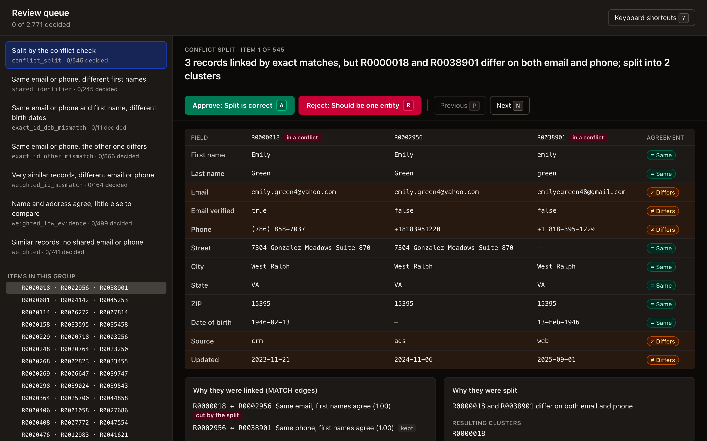
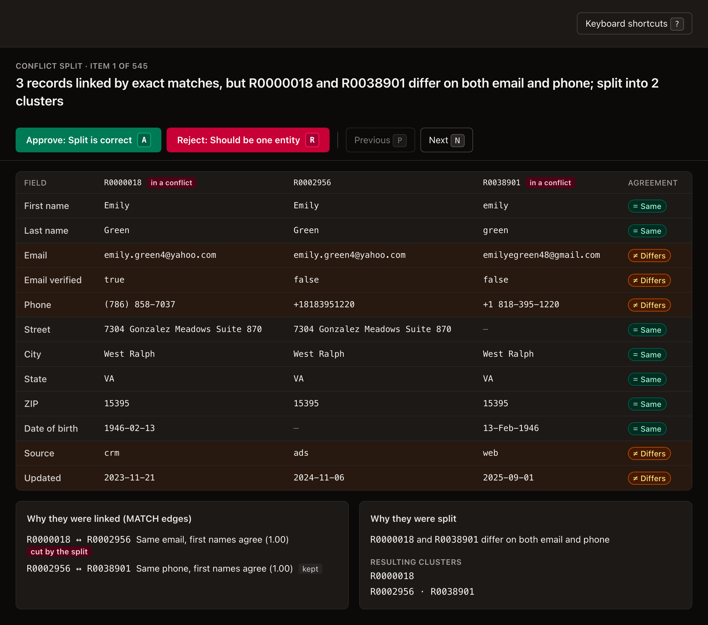

# Entity Resolution Toolkit

[](https://github.com/traycn/entity-resolution/actions/workflows/ci.yml)

Find and safely merge duplicate customer records across systems, with every decision explained and measured.

## Problem
The same customer often exists as several records across CRM, ad platforms, and web forms because of inconsistent entry points and formatting. That fragments history and skews metrics. Naive dedupe makes it worse by merging people who aren't the same: a parent and child with the same name, two people sharing a household phone, or someone whose phone and email both changed over the years.

## Approach
- **Normalize** names (nicknames like Bob → Robert), emails (gmail dots and `+tags`), phones (E.164), addresses (St → Street) and dates.
- **Block** on three keys (email local part, last 7 phone digits, Soundex name + ZIP) and take the union, so only a few pairs per record are compared.
- **Decide** each pair with explicit rules, in order. Only an exact email or phone match whose first names agree can merge automatically; birth dates and the second identifier can still send it to review. A weighted fuzzy score only chooses between human review and no match. Every decision stores the rule that fired and every field score.
- **Never merge conflicting identifiers.** Two records with different emails *and* different phones are never merged, even through a chain of other records: conflict-aware clustering splits such chains.
- **Merge** with survivorship rules (verified source, then most recent), keeping field groups such as the address together, recording each field's source record, and logging every merge so it can be undone.
- **Review** borderline pairs and every conflict split in a keyboard-driven UI.
- **Measure** against labeled synthetic ground truth on six seeds, three of them held out, and choose policies by measurement: four auto-merge policies are compared on the same data.

## Result
_Written by `make eval` and `make compare` between the markers below; do not edit by hand._

<!-- headline:start -->
**Pairwise precision 0.9999** (mean over 6 seeds, range 0.9998-1.0000) at **0.8698 recall on ordinary duplicates**, with 0 hard_dup merges. 2 of the 4 wrong-entity pairs across all seeds involve a same-name parent and child (Jr./Sr.); every wrong merge links different people through a shared phone or email. See [Known limitations](docs/results.md#known-limitations).
<!-- headline:end -->

### Auto-merge policy comparison
Same six seeds for every policy. The shipped policy is in bold; see [docs/results.md](docs/results.md#exact-id-policy-comparison) for per-seed numbers.

<!-- policies:start -->
Same data for every policy (seeds 42, 7, 1234, 2026, 99, 31337). Only pairs that reach the exact-ID branch with agreeing first names are re-decided. Shipped policy: **refined (name-aware + DOB mismatch)** (reproduces `score_pair` exactly).

Mean over all seeds (Jr./Sr. and mixed clusters summed):

| Policy | Precision | Ordinary recall | REVIEW queue | drift_chain merged | Mixed clusters | Jr./Sr. pairs MATCHed |
|---|---:|---:|---:|---:|---:|---:|
| original (no mismatch rule) | 0.9999 | 0.8876 | 1,662 | 739 / 2,250 | 4 | 118 / 118 |
| strict (any other-ID mismatch) | 0.9999 | 0.7378 | 4,990 | 0 / 2,250 | 2 | 30 / 118 |
| **refined (name-aware + DOB mismatch)** | 0.9999 | 0.8698 | 2,208 | 649 / 2,250 | 3 | 6 / 118 |
| refined + missing-DOB guard | 1.0000 | 0.8431 | 2,902 | 520 / 2,250 | 2 | 1 / 118 |
<!-- policies:end -->

### Seed 42 detail
<!-- results:start -->
Detail for seed 42, 50,000 synthetic records. Every seed, recall by duplicate kind, cluster-level metrics and the threshold sweep: [docs/results.md](docs/results.md).

| Metric | Value |
|---|---|
| Records processed | 50,000 |
| Duplicates resolved | 10,051 records merged away |
| Pairwise precision | 0.9998 (2 wrong-entity pairs; 0 of 238 hard_dup pairs merged) |
| Pairwise recall | 0.8659 on ordinary duplicates; 0.7644 on all true pairs |
| Pairs sent to human review | 2,226 |
| Runtime (50k records) | 4.8 s (block, normalize, score, cluster) |
<!-- results:end -->

## How it works
[docs/architecture.md](docs/architecture.md) has the pipeline, the decision flow of every rule, clustering and survivorship, and the review loop, as Mermaid diagrams. [docs/results.md](docs/results.md) has every measured number, per seed.

## Review UI
`make review` opens a queue of every pair the scorer was unsure about, grouped by the rule that fired, plus every cluster the conflict check split. Each item shows the records side by side with a per-field *same / differs* badge, the field scores and weights, the rule in plain words ("Same phone, different first names") and, for splits, the links that connected the records and the conflicts that split them.



A conflict-split item: three records joined by a shared email and a shared phone, where the first and last differ on both. The split cut the email link and kept the phone link.



| Key | Action |
|---|---|
| <kbd>A</kbd> | Approve (pair: same person; split: split is correct) |
| <kbd>R</kbd> | Reject (pair: different people; split: should be one entity) |
| <kbd>N</kbd> / <kbd>J</kbd>, <kbd>P</kbd> / <kbd>K</kbd> | Next / previous item |
| <kbd>U</kbd> | Next undecided item |
| <kbd>?</kbd> | Show shortcuts |

Decisions are appended to `data/review_decisions.csv`, one row per click (the latest row per item wins). `make apply-review` applies them: approved pairs merge, rejected pairs are kept apart, and the result goes to `out/reviewed/` with a report of what each decision did. The safety rule still wins, so "should be one entity" on a conflict split is refused.

## Run it
Prerequisites: Python 3.12 with [uv](https://docs.astral.sh/uv/), `make`, and Node 22 for the review UI only.

```bash
uv sync
make all      # generate → resolve → evaluate → compare policies (about 3 minutes)
make review   # review UI at http://127.0.0.1:5173 (API on :8000); Ctrl-C stops both
```

Upgrading an existing checkout from before v1.0.0? Run `uv sync --reinstall-package entity-resolution` once to restore the `resolver` command.

| Target | What it does |
|---|---|
| `make data` | Generate 50,000 synthetic records with known duplicates (seed 42) |
| `make resolve` | Block, score, cluster and merge into `out/` |
| `make eval` | Score `out/` against ground truth, rerun five more seeds, write `docs/results.md` and the README Result |
| `make compare` | Compare the four auto-merge policies on six seeds |
| `make apply-review` | Re-cluster with the review decisions applied, into `out/reviewed/` |
| `make review` | Start the review API and UI |
| `make test`, `make lint` | pytest; ruff and `mypy --strict` |

CI checks formatting, lint, types and tests, builds the review UI, and runs `make all` on a clean checkout, failing if the committed results above don't reproduce.

### Install as a dependency
The distribution is `entity-resolution`; the import name stays `resolver`. Pin a release tag (`v1.0.0` once it is tagged):

```bash
uv add "entity-resolution @ git+https://github.com/traycn/entity-resolution@v1.0.0"
```

`config.toml` ships inside the package. Point `RESOLVER_CONFIG` at another file to override it.

## Repository layout
```
src/resolver/   normalize, blocking, scoring, merge, review queue + API, CLI
data/           generate.py (synthetic sources + ground truth)
eval/           evaluate.py, compare_policies.py, per-stage reports
review-ui/      Vite + React + Tailwind review page
docs/           architecture.md, results.md, threshold sweep chart
src/resolver/config.toml  thresholds, weights and the auto-merge policy
```

## Limitations
- **Synthetic data.** Every number comes from a generator, not production data. Its birth dates are never mistyped, so the cost of the DOB check is likely understated.
- **Known wrong merges.** A same-name parent and child with a birth date missing, or household members with similar first names sharing a phone, can still merge; both are measured under [Known limitations](docs/results.md#known-limitations).
- **Birth dates keep same-name relatives apart in clustering (v1.1.0).** Two records with the same first name and different birth dates are never clustered together, even through a third record that has no birth date. A reviewer can approve that exact pair to override it, because DOB typos happen.
- **Reviewers cannot override the safety rule.** A conflict split confirmed as one person (identity drift: an old phone, then a new email) stays split even after review.
