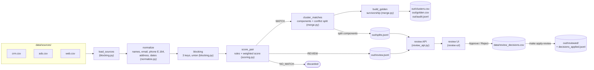
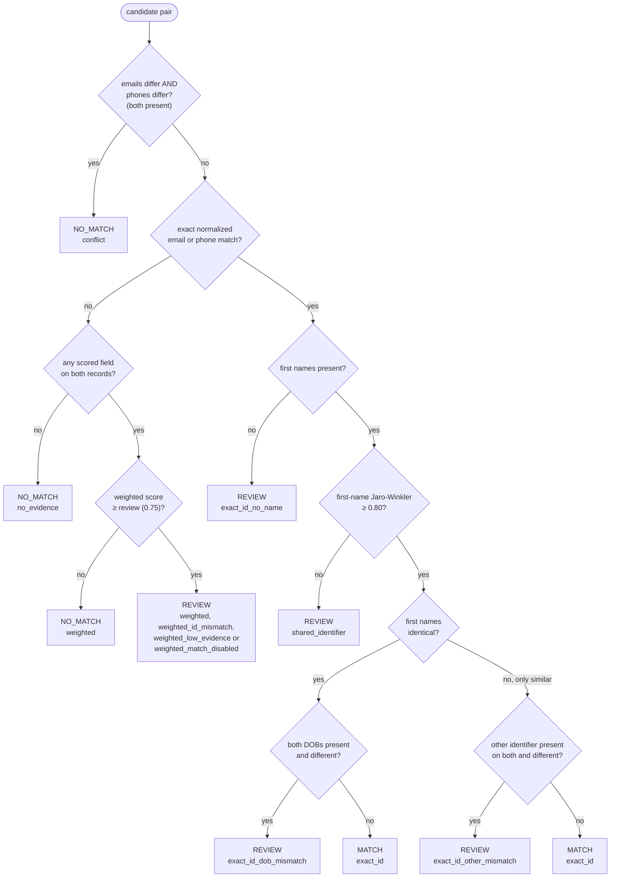
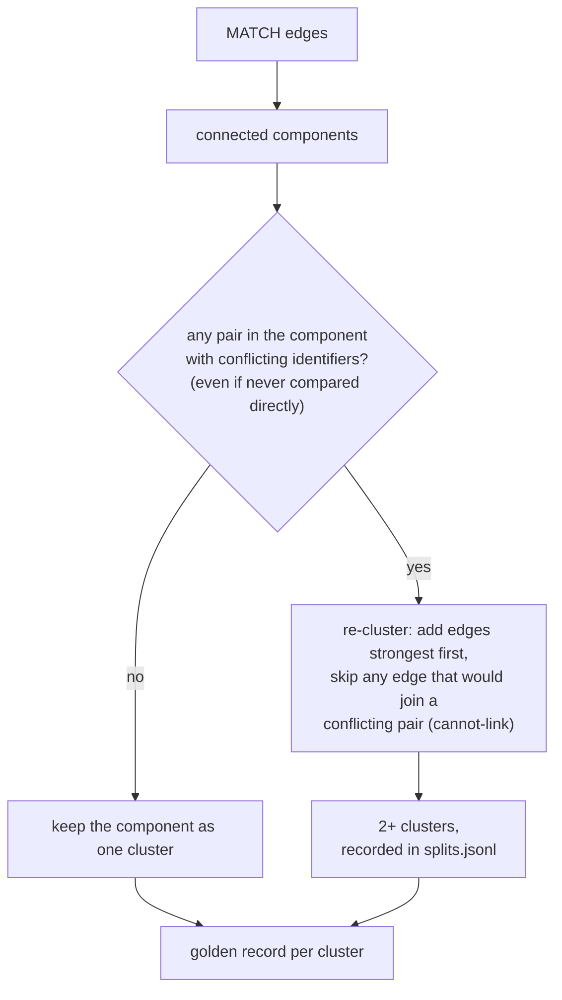
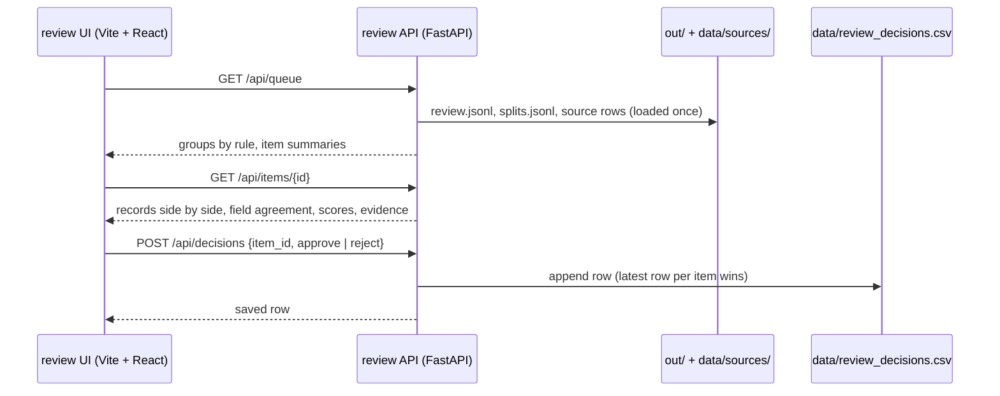

# Architecture

The resolver is a batch pipeline: read every source, normalize, generate candidate
pairs, decide each pair, cluster the merges, and write golden records plus an audit
trail. Pairs it is not sure about go to a human review queue. A separate evaluation
layer measures the whole thing against the generator's ground truth.

## Pipeline

`resolver run` (`src/resolver/cli.py`) runs everything left of the review API and
writes every file under `out/`. `make apply-review` runs it again with the review
decisions applied and writes `out/reviewed/`, so `out/` always stays the automatic
result that evaluation and CI measure.

## Blocking

Comparing all 50,000 records pairwise would be 1.25 billion pairs. Each blocking key
groups records that share a cheap key; only records in the same block are compared.
The candidate set is the **union** over keys, so a record missed by one key (no email,
a typo in the name) can still be caught by another.

| Key | Value | Catches |
|---|---|---|
| `email_local` | local part of the normalized email (gmail dots and `+tags` removed) | same address, any formatting |
| `phone_last7` | last 7 digits of the E.164 phone | same number, any formatting or area-code noise |
| `name_soundex_zip` | Soundex of the last name, and separately of the first name, plus ZIP | typos and swapped first/last names at one address |

A block larger than `MAX_BLOCK_SIZE` (50) is dropped for that key, such as a shared
`info@` mailbox; other keys can still recover its true pairs. Pair completeness and
reduction ratio are in [results.md](results.md#blocking-pair-completeness-m3).

## Pair decisions

`score_pair` (`src/resolver/scoring.py`) returns `MATCH`, `REVIEW` or `NO_MATCH`, plus
an explanation: the rule that fired, every field score, the weights used and the gate
checks. Rules are tried in this order; the first one that applies decides.

- **Only an exact email or phone match can auto-merge.** The weighted fuzzy score
  (email 0.35, phone 0.25, name 0.25, address 0.15, re-normalized over the fields present
  on both records) only chooses between `REVIEW` and `NO_MATCH`, because
  `allow_weighted_match = false` in `config.toml`. Name and address alone cannot tell a
  person from a same-named relative at the same address.
- **The safety rule comes first.** Two records with different emails *and* different
  phones are never merged directly. `tests/test_safety.py` covers it.
- **The exact-ID gates** were chosen by measurement. The original, strict, refined and
  refined + missing-DOB-guard policies are compared on six seeds in
  [results.md](results.md#exact-id-policy-comparison); the refined policy ships.

Thresholds and weights live in `config.toml` (`RESOLVER_CONFIG` overrides the path).

## Clustering and survivorship

Transitive links can join records that conflict: A shares an email with B, B shares
a phone with C, and A and C differ on both. This is how identity drift looks (an old
phone, then a new email). The conflict check splits such components; each split is
written to `out/splits.jsonl` with every MATCH edge's explanation, the conflicting
pairs, the edges it cut and the resulting clusters, and appears in the review queue.

**Survivorship** (`build_golden`) ranks a cluster's records by verified email first,
then most recent `updated_at`, then record id, and takes each field group whole from
the best-ranked record that has it: name (first + last), email (+ verified flag),
phone, address (street + city + state + ZIP), DOB. A golden address therefore never
mixes one record's street with another's ZIP. Each golden field records its source
`record_id`.

**Audit and undo.** Every multi-record cluster gets an `out/audit.jsonl` entry with
the MATCH explanations that joined it, any edges the conflict check cut, the golden
record and the untouched source rows; `merge.unmerge` restores the originals from it.

## Review

`make review` serves the API on `127.0.0.1:8000` and the page on
`http://127.0.0.1:5173`, which proxies `/api`. Each decision row stores the raw choice
and what it means: `same_entity` / `different_entities` for a pair,
`split_correct` / `split_wrong` for a conflict split.

### Applying decisions

`make apply-review` (`resolver run --decisions data/review_decisions.csv --out
out/reviewed`) re-clusters with the latest decision per item:

| Decision | Applied as | Status in `decisions_applied.jsonl` |
|---|---|---|
| pair, Approve (same person) | a `human_approved` link, added before automatic edges when a component is re-clustered | `merged`, or `cut_by_safety_rule` |
| pair, Reject (different people) | a cannot-link pair, kept apart like conflicting identifiers | `separated` or `already_apart` |
| split, Approve (split is correct) | nothing to change | `split_kept` |
| split, Reject (should be one entity) | **refused**: it would merge records whose email and phone both differ | `refused_safety_rule` |
| item no longer in this run's queue | ignored (data regenerated or config changed) | `stale` |

The safety rule outranks reviewers: no decision can put conflicting identifiers in
one cluster. Approved links keep their field scores in the audit log under
`rule="human_approved"`, so a merge stays explainable and can be undone like any other.

## Evaluation

| Script | Make target | Measures | Writes |
|---|---|---|---|
| `eval/evaluate.py` | `make eval` | pairwise and cluster precision / recall / F1 by duplicate kind, blocking completeness, Jr./Sr. outcomes, the `min_first_name_similarity` sweep, on seed 42 (from `out/`) plus 5 regenerated seeds | `docs/results.md`, `docs/threshold_sweep.png`, README Result blocks |
| `eval/compare_policies.py` | `make compare` | four exact-ID policies on the same six seeds; checks that exactly one reproduces `score_pair` | policy and DOB-gap blocks of `docs/results.md` and README |
| `eval/blocking_report.py`, `eval/merge_report.py` | `make blocking-report`, `make merge-report` | per-stage diagnostics | console only |
| `eval/scoring_report.py` | (none: `uv run python eval/scoring_report.py`) | decision counts by duplicate kind and rule | console only |

Ground truth comes from `data/generate.py`, which labels every record (`original`,
`dup`, `hard_dup`, `drift_chain`, `household_same_name`) and is deterministic per seed.
CI runs `make all` on a clean checkout and fails if the committed results differ
(runtimes excepted).

## Files

| Path | Written by | Contents |
|---|---|---|
| `data/sources/{crm,ads,web}.csv` | `make data` | synthetic source records |
| `data/truth.csv` | `make data` | `record_id, entity_id, dup_type` |
| `out/clusters.csv` | `resolver run` | `record_id, cluster_id` for every record |
| `out/golden.csv` | `resolver run` | one golden record per cluster, with per-field source ids |
| `out/audit.jsonl` | `resolver run` | one entry per merge, enough to undo it |
| `out/splits.jsonl` | `resolver run` | components split by the conflict check, with evidence |
| `out/review.jsonl` | `resolver run` | every REVIEW pair with its explanation |
| `data/review_decisions.csv` | review UI | append-only human decisions (gitignored) |
| `out/reviewed/*`, `decisions_applied.jsonl` | `make apply-review` | the same outputs with review decisions applied, and what each decision did |
| `docs/results.md`, `docs/threshold_sweep.png` | `make eval`, `make compare` | measured results |
