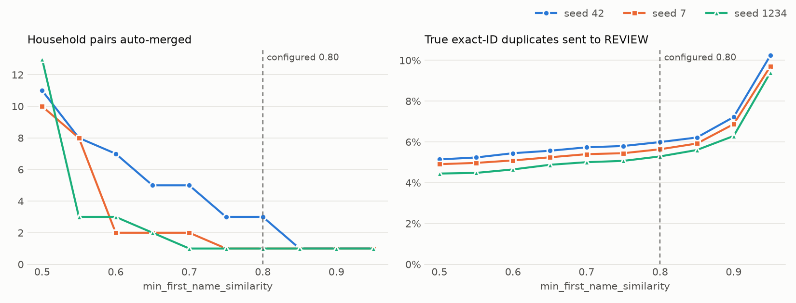

# Evaluation results

_Generated by `make eval` (`eval/evaluate.py`); do not edit by hand._

Synthetic data: `--n 50000 --dup-rate 0.25`, seeds 42, 7, 1234. Seed 42 is scored from `out/clusters.csv` as written by `resolver run`; the other seeds are generated and resolved in-process with the same code. Config: `min_first_name_similarity = 0.8`, `allow_weighted_match = false`, review threshold 0.75.

Held-out seeds (2026, 99, 31337) were added after the thresholds and rules were chosen on the seeds above; they are in every table but not in the sweep chart.

Duplicate kinds: **ordinary** pairs; **hard_dup** pairs (differ on both email and phone, so the safety rule must not merge them; a merged one is never counted as a true positive); **drift_chain** pairs (3-record identity-drift entities whose first and last records conflict, so at most 1 of each chain's 3 pairs can be co-clustered: recall is capped at 0.333 by design).

## Headline (pairwise, over co-clustered record pairs)

| Seed | Precision | Recall (ordinary) | F1 (ordinary) | Recall (all true pairs) | hard_dup merged | drift_chain found | Mixed clusters |
|---:|---:|---:|---:|---:|---:|---:|---:|
| 42 | 0.9998 | 0.8659 | 0.9280 | 0.7644 | 0 / 238 | 642 / 2,250 | 1 |
| 7 | 1.0000 | 0.8731 | 0.9323 | 0.7651 | 0 / 312 | 632 / 2,250 | 0 |
| 1234 | 0.9999 | 0.8694 | 0.9301 | 0.7644 | 0 / 299 | 658 / 2,250 | 1 |
| 2026 (held out) | 0.9999 | 0.8666 | 0.9285 | 0.7626 | 0 / 295 | 662 / 2,250 | 1 |
| 99 (held out) | 1.0000 | 0.8759 | 0.9339 | 0.7712 | 0 / 287 | 658 / 2,250 | 0 |
| 31337 (held out) | 1.0000 | 0.8680 | 0.9294 | 0.7638 | 0 / 291 | 644 / 2,250 | 0 |

Precision = co-clustered pairs of the same entity (excluding hard_dup) / all co-clustered pairs. False positives (pairs of different entities): seed 42: 2, seed 7: 0, seed 1234: 1, seed 2026 (held out): 1, seed 99 (held out): 0, seed 31337 (held out): 0.

## Exact-ID policy comparison

_Written by `make compare` (`eval/compare_policies.py`)._

<!-- policies:start -->
Same data for every policy (seeds 42, 7, 1234, 2026, 99, 31337). Only pairs that reach the exact-ID branch with agreeing first names are re-decided. Shipped policy: **refined (name-aware + DOB mismatch)** (reproduces `score_pair` exactly).

Mean over all seeds (Jr./Sr. and mixed clusters summed):

| Policy | Precision | Ordinary recall | REVIEW queue | drift_chain merged | Mixed clusters | Jr./Sr. pairs MATCHed |
|---|---:|---:|---:|---:|---:|---:|
| original (no mismatch rule) | 0.9999 | 0.8876 | 1,662 | 739 / 2,250 | 4 | 118 / 118 |
| strict (any other-ID mismatch) | 0.9999 | 0.7378 | 4,990 | 0 / 2,250 | 2 | 30 / 118 |
| **refined (name-aware + DOB mismatch)** | 0.9999 | 0.8698 | 2,208 | 649 / 2,250 | 3 | 6 / 118 |
| refined + missing-DOB guard | 1.0000 | 0.8431 | 2,902 | 520 / 2,250 | 2 | 1 / 118 |

Per seed:

| Seed | Policy | Precision | Ordinary recall | REVIEW | drift_chain merged | Mixed | Jr./Sr. MATCHed | Children merged |
|---:|---|---:|---:|---:|---:|---:|---:|---:|
| 42 | original (no mismatch rule) | 0.9998 | 0.8855 | 1,649 | 737 | 1 | 12 / 12 | 0 / 14 |
| 42 | strict (any other-ID mismatch) | 0.9998 | 0.7340 | 4,999 | 0 | 1 | 4 / 12 | 0 / 14 |
| 42 | refined (name-aware + DOB mismatch) | 0.9998 | 0.8659 | 2,226 | 642 | 1 | 1 / 12 | 0 / 14 |
| 42 | refined + missing-DOB guard | 0.9998 | 0.8387 | 2,937 | 506 | 1 | 0 / 12 | 0 / 14 |
| 7 | original (no mismatch rule) | 0.9999 | 0.8897 | 1,640 | 737 | 1 | 17 / 17 | 1 / 13 |
| 7 | strict (any other-ID mismatch) | 1.0000 | 0.7390 | 4,982 | 0 | 0 | 3 / 17 | 0 / 13 |
| 7 | refined (name-aware + DOB mismatch) | 1.0000 | 0.8731 | 2,187 | 632 | 0 | 1 / 17 | 0 / 13 |
| 7 | refined + missing-DOB guard | 1.0000 | 0.8444 | 2,885 | 514 | 0 | 0 / 17 | 0 / 13 |
| 1234 | original (no mismatch rule) | 0.9999 | 0.8868 | 1,682 | 738 | 1 | 28 / 28 | 1 / 29 |
| 1234 | strict (any other-ID mismatch) | 0.9999 | 0.7403 | 4,935 | 0 | 1 | 7 / 28 | 1 / 29 |
| 1234 | refined (name-aware + DOB mismatch) | 0.9999 | 0.8694 | 2,194 | 658 | 1 | 1 / 28 | 1 / 29 |
| 1234 | refined + missing-DOB guard | 0.9999 | 0.8438 | 2,885 | 523 | 1 | 1 / 28 | 1 / 29 |
| 2026 | original (no mismatch rule) | 0.9999 | 0.8833 | 1,671 | 742 | 1 | 31 / 31 | 1 / 25 |
| 2026 | strict (any other-ID mismatch) | 1.0000 | 0.7395 | 4,948 | 0 | 0 | 8 / 31 | 0 / 25 |
| 2026 | refined (name-aware + DOB mismatch) | 0.9999 | 0.8666 | 2,198 | 662 | 1 | 1 / 31 | 1 / 25 |
| 2026 | refined + missing-DOB guard | 1.0000 | 0.8413 | 2,885 | 532 | 0 | 0 / 31 | 0 / 25 |
| 99 | original (no mismatch rule) | 1.0000 | 0.8928 | 1,610 | 742 | 0 | 11 / 11 | 0 / 12 |
| 99 | strict (any other-ID mismatch) | 1.0000 | 0.7379 | 4,993 | 0 | 0 | 2 / 11 | 0 / 12 |
| 99 | refined (name-aware + DOB mismatch) | 1.0000 | 0.8759 | 2,132 | 658 | 0 | 2 / 11 | 0 / 12 |
| 99 | refined + missing-DOB guard | 1.0000 | 0.8484 | 2,838 | 525 | 0 | 0 / 11 | 0 / 12 |
| 31337 | original (no mismatch rule) | 1.0000 | 0.8875 | 1,718 | 740 | 0 | 19 / 19 | 0 / 23 |
| 31337 | strict (any other-ID mismatch) | 1.0000 | 0.7365 | 5,081 | 0 | 0 | 6 / 19 | 0 / 23 |
| 31337 | refined (name-aware + DOB mismatch) | 1.0000 | 0.8680 | 2,312 | 644 | 0 | 0 / 19 | 0 / 23 |
| 31337 | refined + missing-DOB guard | 1.0000 | 0.8421 | 2,982 | 520 | 0 | 0 / 19 | 0 / 23 |
<!-- policies:end -->

## Pipeline

| Seed | Records | Candidate pairs | MATCH | REVIEW | NO_MATCH | Clusters | Records merged away | Components split | Runtime |
|---:|---:|---:|---:|---:|---:|---:|---:|---:|---:|
| 42 | 50,000 | 17,160 | 11,723 | 2,226 | 3,211 | 39,949 | 10,051 | 546 | 4.8s |
| 7 | 50,000 | 17,121 | 11,730 | 2,187 | 3,204 | 39,929 | 10,071 | 548 | 4.8s |
| 1234 | 50,000 | 16,963 | 11,731 | 2,194 | 3,038 | 39,949 | 10,051 | 562 | 4.9s |
| 2026 (held out) | 50,000 | 16,981 | 11,697 | 2,198 | 3,086 | 39,931 | 10,069 | 555 | 4.8s |
| 99 (held out) | 50,000 | 17,004 | 11,869 | 2,132 | 3,003 | 39,846 | 10,154 | 561 | 4.8s |
| 31337 (held out) | 50,000 | 17,246 | 11,759 | 2,312 | 3,175 | 39,943 | 10,057 | 543 | 4.9s |

Runtime is block + normalize + score + cluster, in-process (no golden records or file output).

## Pairwise recall by duplicate kind

| Seed | ordinary | hard_dup | drift_chain (cap 0.333) | all |
|---:|---:|---:|---:|---:|
| 42 | 10,747 / 12,412 = 0.8659 | 0 / 238 = 0.0000 | 642 / 2,250 = 0.2853 | 11,389 / 14,900 = 0.7644 |
| 7 | 10,730 / 12,289 = 0.8731 | 0 / 312 = 0.0000 | 632 / 2,250 = 0.2809 | 11,362 / 14,851 = 0.7651 |
| 1234 | 10,682 / 12,286 = 0.8694 | 0 / 299 = 0.0000 | 658 / 2,250 = 0.2924 | 11,340 / 14,835 = 0.7644 |
| 2026 (held out) | 10,663 / 12,305 = 0.8666 | 0 / 295 = 0.0000 | 662 / 2,250 = 0.2942 | 11,325 / 14,850 = 0.7626 |
| 99 (held out) | 10,860 / 12,398 = 0.8759 | 0 / 287 = 0.0000 | 658 / 2,250 = 0.2924 | 11,518 / 14,935 = 0.7712 |
| 31337 (held out) | 10,795 / 12,436 = 0.8680 | 0 / 291 = 0.0000 | 644 / 2,250 = 0.2862 | 11,439 / 14,977 = 0.7638 |

The hard_dup column counts merges the safety rule should have prevented; it is expected to be 0. "all" here counts hard_dup merges as found.

## Cluster level (exact match)

A predicted cluster is correct only if it holds exactly the records of one true entity. *All* includes singletons (an un-duplicated entity left alone counts); *multi-record* keeps only predicted clusters and true entities with ≥ 2 records.

| Seed | Scope | Predicted | True entities | Exact | Precision | Recall | F1 |
|---:|---|---:|---:|---:|---:|---:|---:|
| 42 | all | 39,949 | 37,500 | 35,179 | 0.8806 | 0.9381 | 0.9084 |
| 42 | multi-record | 8,835 | 10,253 | 7,933 | 0.8979 | 0.7737 | 0.8312 |
| 7 | all | 39,929 | 37,500 | 35,216 | 0.8820 | 0.9391 | 0.9096 |
| 7 | multi-record | 8,881 | 10,277 | 7,993 | 0.9000 | 0.7778 | 0.8344 |
| 1234 | all | 39,949 | 37,500 | 35,154 | 0.8800 | 0.9374 | 0.9078 |
| 1234 | multi-record | 8,875 | 10,303 | 7,958 | 0.8967 | 0.7724 | 0.8299 |
| 2026 (held out) | all | 39,931 | 37,500 | 35,182 | 0.8811 | 0.9382 | 0.9087 |
| 2026 (held out) | multi-record | 8,928 | 10,306 | 7,989 | 0.8948 | 0.7752 | 0.8307 |
| 99 (held out) | all | 39,846 | 37,500 | 35,264 | 0.8850 | 0.9404 | 0.9119 |
| 99 (held out) | multi-record | 8,924 | 10,232 | 7,996 | 0.8960 | 0.7815 | 0.8348 |
| 31337 (held out) | all | 39,943 | 37,500 | 35,185 | 0.8809 | 0.9383 | 0.9087 |
| 31337 (held out) | multi-record | 8,814 | 10,202 | 7,887 | 0.8948 | 0.7731 | 0.8295 |

## Same-name households (Jr./Sr.)

A same-name child (`household_same_name`, one record) shares the parent's first and last name and phone or email, with a different birth date. A Jr./Sr. pair is a candidate pair of the child's record with another entity's record that shares an exact normalized email or phone. None may be MATCHed.

| Seed | Children | Jr./Sr. pairs | MATCH | REVIEW | NO_MATCH | Children merged | Rules |
|---:|---:|---:|---:|---:|---:|---:|---|
| 42 | 14 | 12 | 1 | 11 | 0 | 0 | MATCH/exact_id 1, REVIEW/exact_id_dob_mismatch 11 |
| 7 | 13 | 17 | 1 | 16 | 0 | 0 | MATCH/exact_id 1, REVIEW/exact_id_dob_mismatch 14, REVIEW/exact_id_other_mismatch 2 |
| 1234 | 29 | 28 | 1 | 27 | 0 | 1 | MATCH/exact_id 1, REVIEW/exact_id_dob_mismatch 26, REVIEW/exact_id_other_mismatch 1 |
| 2026 (held out) | 25 | 31 | 1 | 30 | 0 | 1 | MATCH/exact_id 1, REVIEW/exact_id_dob_mismatch 30 |
| 99 (held out) | 12 | 11 | 2 | 9 | 0 | 0 | MATCH/exact_id 2, REVIEW/exact_id_dob_mismatch 9 |
| 31337 (held out) | 23 | 19 | 0 | 19 | 0 | 0 | REVIEW/exact_id_dob_mismatch 19 |

## Blocking pair completeness (M3)

Share of true duplicate pairs that survive blocking, by kind.

| Seed | ordinary | hard_dup | drift_chain | all | Reduction ratio |
|---:|---:|---:|---:|---:|---:|
| 42 | 12,238 / 12,412 = 0.9860 | 205 / 238 = 0.8613 | 2,191 / 2,250 = 0.9738 | 14,634 / 14,900 = 0.9821 | 0.999986 |
| 7 | 12,134 / 12,289 = 0.9874 | 273 / 312 = 0.8750 | 2,188 / 2,250 = 0.9724 | 14,595 / 14,851 = 0.9828 | 0.999986 |
| 1234 | 12,123 / 12,286 = 0.9867 | 256 / 299 = 0.8562 | 2,181 / 2,250 = 0.9693 | 14,560 / 14,835 = 0.9815 | 0.999986 |
| 2026 (held out) | 12,144 / 12,305 = 0.9869 | 257 / 295 = 0.8712 | 2,171 / 2,250 = 0.9649 | 14,572 / 14,850 = 0.9813 | 0.999986 |
| 99 (held out) | 12,250 / 12,398 = 0.9881 | 263 / 287 = 0.9164 | 2,189 / 2,250 = 0.9729 | 14,702 / 14,935 = 0.9844 | 0.999986 |
| 31337 (held out) | 12,255 / 12,436 = 0.9854 | 247 / 291 = 0.8488 | 2,192 / 2,250 = 0.9742 | 14,694 / 14,977 = 0.9811 | 0.999986 |

## `min_first_name_similarity` sweep

An exact email/phone match auto-merges only when the first names agree at this threshold. *Households* are candidate pairs of different people that share an exact normalized email or phone; *exact-ID duplicates* are true pairs that do.

| Seed | Threshold | Households merged | Exact-ID dups to REVIEW | Mixed clusters | Precision | Recall (ordinary) |
|---:|---:|---:|---:|---:|---:|---:|
| 42 | 0.50 | 11 / 78 | 641 / 12,467 (5.14%) | 7 | 0.9986 | 0.8747 |
| 42 | 0.55 | 8 / 78 | 653 / 12,467 (5.24%) | 4 | 0.9992 | 0.8738 |
| 42 | 0.60 | 7 / 78 | 679 / 12,467 (5.45%) | 3 | 0.9993 | 0.8714 |
| 42 | 0.65 | 5 / 78 | 694 / 12,467 (5.57%) | 2 | 0.9995 | 0.8701 |
| 42 | 0.70 | 5 / 78 | 715 / 12,467 (5.74%) | 2 | 0.9995 | 0.8685 |
| 42 | 0.75 | 3 / 78 | 723 / 12,467 (5.80%) | 1 | 0.9998 | 0.8680 |
| 42 | **0.80** | 3 / 78 | 747 / 12,467 (5.99%) | 1 | 0.9998 | 0.8659 |
| 42 | 0.85 | 1 / 78 | 775 / 12,467 (6.22%) | 0 | 1.0000 | 0.8636 |
| 42 | 0.90 | 1 / 78 | 900 / 12,467 (7.22%) | 0 | 1.0000 | 0.8530 |
| 42 | 0.95 | 1 / 78 | 1,277 / 12,467 (10.24%) | 0 | 1.0000 | 0.8204 |
| 7 | 0.50 | 10 / 86 | 610 / 12,430 (4.91%) | 7 | 0.9989 | 0.8811 |
| 7 | 0.55 | 8 / 86 | 618 / 12,430 (4.97%) | 5 | 0.9990 | 0.8805 |
| 7 | 0.60 | 2 / 86 | 633 / 12,430 (5.09%) | 1 | 0.9998 | 0.8790 |
| 7 | 0.65 | 2 / 86 | 652 / 12,430 (5.25%) | 1 | 0.9998 | 0.8773 |
| 7 | 0.70 | 2 / 86 | 671 / 12,430 (5.40%) | 1 | 0.9998 | 0.8757 |
| 7 | 0.75 | 1 / 86 | 677 / 12,430 (5.45%) | 0 | 1.0000 | 0.8752 |
| 7 | **0.80** | 1 / 86 | 701 / 12,430 (5.64%) | 0 | 1.0000 | 0.8731 |
| 7 | 0.85 | 1 / 86 | 736 / 12,430 (5.92%) | 0 | 1.0000 | 0.8702 |
| 7 | 0.90 | 1 / 86 | 854 / 12,430 (6.87%) | 0 | 1.0000 | 0.8608 |
| 7 | 0.95 | 1 / 86 | 1,207 / 12,430 (9.71%) | 0 | 1.0000 | 0.8311 |
| 1234 | 0.50 | 13 / 93 | 551 / 12,385 (4.45%) | 11 | 0.9984 | 0.8780 |
| 1234 | 0.55 | 3 / 93 | 555 / 12,385 (4.48%) | 3 | 0.9997 | 0.8776 |
| 1234 | 0.60 | 3 / 93 | 576 / 12,385 (4.65%) | 3 | 0.9996 | 0.8760 |
| 1234 | 0.65 | 2 / 93 | 604 / 12,385 (4.88%) | 2 | 0.9998 | 0.8736 |
| 1234 | 0.70 | 1 / 93 | 620 / 12,385 (5.01%) | 1 | 0.9999 | 0.8723 |
| 1234 | 0.75 | 1 / 93 | 628 / 12,385 (5.07%) | 1 | 0.9999 | 0.8716 |
| 1234 | **0.80** | 1 / 93 | 655 / 12,385 (5.29%) | 1 | 0.9999 | 0.8694 |
| 1234 | 0.85 | 1 / 93 | 694 / 12,385 (5.60%) | 1 | 0.9999 | 0.8661 |
| 1234 | 0.90 | 1 / 93 | 779 / 12,385 (6.29%) | 1 | 0.9999 | 0.8589 |
| 1234 | 0.95 | 1 / 93 | 1,165 / 12,385 (9.41%) | 1 | 0.9999 | 0.8266 |
| 2026 (held out) | 0.50 | 7 / 85 | 556 / 12,363 (4.50%) | 5 | 0.9994 | 0.8761 |
| 2026 (held out) | 0.55 | 7 / 85 | 567 / 12,363 (4.59%) | 5 | 0.9994 | 0.8750 |
| 2026 (held out) | 0.60 | 4 / 85 | 590 / 12,363 (4.77%) | 3 | 0.9996 | 0.8730 |
| 2026 (held out) | 0.65 | 1 / 85 | 608 / 12,363 (4.92%) | 1 | 0.9999 | 0.8714 |
| 2026 (held out) | 0.70 | 1 / 85 | 638 / 12,363 (5.16%) | 1 | 0.9999 | 0.8689 |
| 2026 (held out) | 0.75 | 1 / 85 | 640 / 12,363 (5.18%) | 1 | 0.9999 | 0.8688 |
| 2026 (held out) | **0.80** | 1 / 85 | 667 / 12,363 (5.40%) | 1 | 0.9999 | 0.8666 |
| 2026 (held out) | 0.85 | 1 / 85 | 700 / 12,363 (5.66%) | 1 | 0.9999 | 0.8640 |
| 2026 (held out) | 0.90 | 1 / 85 | 829 / 12,363 (6.71%) | 1 | 0.9999 | 0.8532 |
| 2026 (held out) | 0.95 | 1 / 85 | 1,203 / 12,363 (9.73%) | 1 | 0.9999 | 0.8219 |
| 99 (held out) | 0.50 | 11 / 84 | 581 / 12,529 (4.64%) | 9 | 0.9991 | 0.8827 |
| 99 (held out) | 0.55 | 7 / 84 | 585 / 12,529 (4.67%) | 5 | 0.9994 | 0.8824 |
| 99 (held out) | 0.60 | 4 / 84 | 598 / 12,529 (4.77%) | 2 | 0.9997 | 0.8813 |
| 99 (held out) | 0.65 | 2 / 84 | 615 / 12,529 (4.91%) | 0 | 1.0000 | 0.8799 |
| 99 (held out) | 0.70 | 2 / 84 | 640 / 12,529 (5.11%) | 0 | 1.0000 | 0.8778 |
| 99 (held out) | 0.75 | 2 / 84 | 644 / 12,529 (5.14%) | 0 | 1.0000 | 0.8774 |
| 99 (held out) | **0.80** | 2 / 84 | 662 / 12,529 (5.28%) | 0 | 1.0000 | 0.8759 |
| 99 (held out) | 0.85 | 2 / 84 | 696 / 12,529 (5.56%) | 0 | 1.0000 | 0.8727 |
| 99 (held out) | 0.90 | 2 / 84 | 804 / 12,529 (6.42%) | 0 | 1.0000 | 0.8637 |
| 99 (held out) | 0.95 | 2 / 84 | 1,173 / 12,529 (9.36%) | 0 | 1.0000 | 0.8322 |
| 31337 (held out) | 0.50 | 8 / 94 | 637 / 12,499 (5.10%) | 6 | 0.9987 | 0.8769 |
| 31337 (held out) | 0.55 | 5 / 94 | 643 / 12,499 (5.14%) | 4 | 0.9994 | 0.8764 |
| 31337 (held out) | 0.60 | 3 / 94 | 661 / 12,499 (5.29%) | 2 | 0.9997 | 0.8750 |
| 31337 (held out) | 0.65 | 0 / 94 | 678 / 12,499 (5.42%) | 0 | 1.0000 | 0.8733 |
| 31337 (held out) | 0.70 | 0 / 94 | 714 / 12,499 (5.71%) | 0 | 1.0000 | 0.8700 |
| 31337 (held out) | 0.75 | 0 / 94 | 719 / 12,499 (5.75%) | 0 | 1.0000 | 0.8695 |
| 31337 (held out) | **0.80** | 0 / 94 | 740 / 12,499 (5.92%) | 0 | 1.0000 | 0.8680 |
| 31337 (held out) | 0.85 | 0 / 94 | 774 / 12,499 (6.19%) | 0 | 1.0000 | 0.8652 |
| 31337 (held out) | 0.90 | 0 / 94 | 894 / 12,499 (7.15%) | 0 | 1.0000 | 0.8550 |
| 31337 (held out) | 0.95 | 0 / 94 | 1,262 / 12,499 (10.10%) | 0 | 1.0000 | 0.8240 |

## Known limitations

- **Synthetic birth dates are never corrupted.** The generator only drops a DOB (about 20% of duplicates), never mistypes or reformats it beyond what the normalizer parses, so the DOB guard (`exact_id_dob_mismatch`) sends no true duplicate to REVIEW here and the clustering DOB cannot-link (v1.1.0) never splits one. On real data, DOB typos would turn some true duplicates into REVIEW pairs or splits: their recall cost is likely understated. A reviewer can approve such a pair to lift the cannot-link.
- **A record without a DOB picks a side.** When a DOB-less record matches both a parent and a same-name child, clustering keeps the stronger edge (then the lower record ids) and cuts the other, so a true duplicate can end up with the child. This is the small recall cost of the DOB cannot-link.
- **Households with similar first names.** A shared household phone or email plus first names that clear `min_first_name_similarity` (0.80 Jaro-Winkler, e.g. Margaret / Maria) MATCHes when no second identifier is present to contradict it. These are the wrong-entity pairs that do not involve a Jr./Sr.
- **hard_dup pairs are never merged by design** (they differ on both email and phone), and **drift_chain recall is capped at 1/3** by the conflict check.
<!-- dob-gap:start -->
- **Missing-DOB gap (not closed).** With identical first names and a birth date missing on either side, an exact email/phone match MATCHes even when the other identifier differs, so a same-name parent and child (Jr./Sr.) can still merge. Measured over 6 seeds: refined MATCHes 6 of 118 Jr./Sr. pairs; the missing-DOB guard (identical names, other identifier different, a DOB missing -> REVIEW) brings that to 1 at a cost of 2.67 points of mean ordinary recall (adoption limit: < 0.5 points). The guard was not adopted.
<!-- dob-gap:end -->
